Hi!

I'm Matt. I love old computer hardware, understanding modern computers at a very low level, high performance code and readable, maintainable codebases. Though I may not always succeed on the latter.

- 🔧 [Compiler Explorer](https://godbolt.org) — see what your compiler does with your code
- 📺 [jsbeeb](https://bbc.xania.org) — a BBC Micro emulator in JavaScript
- 🎙️ [Two's Complement](https://www.twoscomplement.org) — a podcast about programming, with Ben Rady
- ✍️ [xania.org](https://xania.org) — my blog

